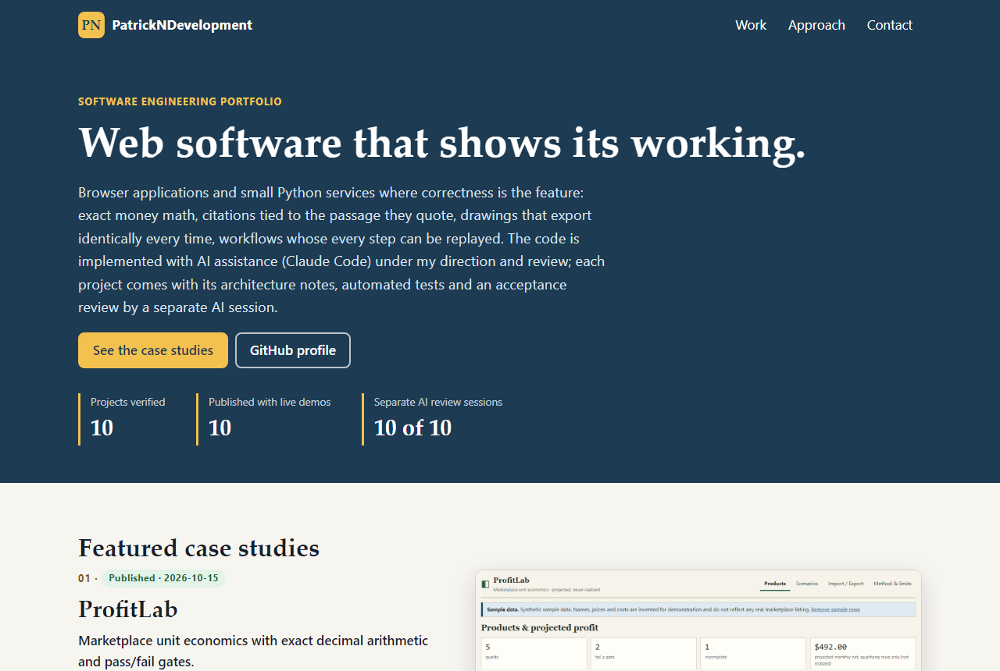

# PatrickNDevelopment.github.io

The portfolio website for the GitHub account `PatrickNDevelopment`: a landing page, four featured
case studies (ProfitLab, RecruitRadar, SourceTrace, SceneForge) and six further project pages, each
built from the projects' own READMEs, test reports and screenshots.



> **Status:** v0.1, built and tested locally. **Not published**: this repository has no remote and
> the site is not live at https://patrickndevelopment.github.io/ yet. All ten projects it presents are
> published with live demos (2026-10-19).

## How it works

- React components are rendered to **static HTML at build time** (`src/render.tsx`,
  `scripts/prerender.mjs`). The site ships **no JavaScript**, no tracking and no cookies.
- Content lives in `src/content/` as typed data. Every statement is taken from the project's own
  documentation; links exist only for repositories and demos that are actually published.
- Screenshots in `public/screens/` are copied from each project's `docs/screenshots/`.
- `sitemap.xml`, `robots.txt`, `404.html`, canonical and Open Graph metadata are generated.
- `scripts/serve.mjs` serves `dist/` the way GitHub Pages serves a user site (directory indexes,
  redirects, `404.html` with status 404); Playwright tests run against it.

## Quick start

Needs Node.js 20.19 or newer.

```powershell
npm ci
npm run dev        # builds, then serves http://localhost:5182/
npm run verify     # format, lint, types, unit tests, build, secret scan, registry check, e2e
```

`scripts\verify.ps1` and `scripts/verify.sh` run the same steps from a clean install and stop on the
first failure. `npm run registry` compares the site's facts with the private portfolio registry when
it is present next to this folder and skips otherwise.

## Documentation

[docs/architecture.md](docs/architecture.md), [docs/test-report.md](docs/test-report.md),
[docs/implementation-report.md](docs/implementation-report.md),
[docs/sample-case-study.md](docs/sample-case-study.md),
[docs/github-profile-README.md](docs/github-profile-README.md) (proposal),
[docs/repository-metadata.md](docs/repository-metadata.md), [docs/handoff.md](docs/handoff.md),
[docs/known-limitations.md](docs/known-limitations.md), [docs/backlog.md](docs/backlog.md),
[SECURITY.md](SECURITY.md), [CONTRIBUTING.md](CONTRIBUTING.md), [AI_ASSISTANCE.md](AI_ASSISTANCE.md).

## License

MIT, see [LICENSE](LICENSE). Screenshots show the author's own projects.
